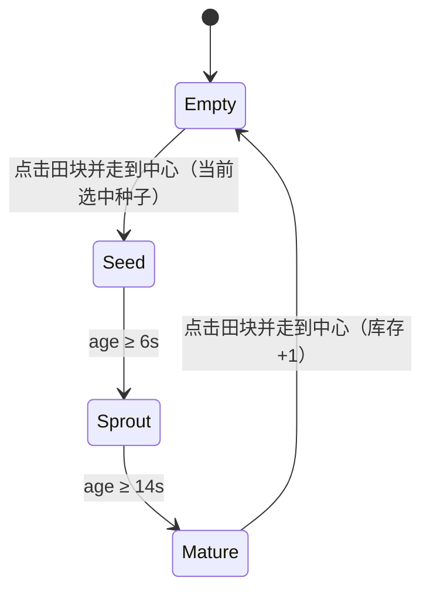
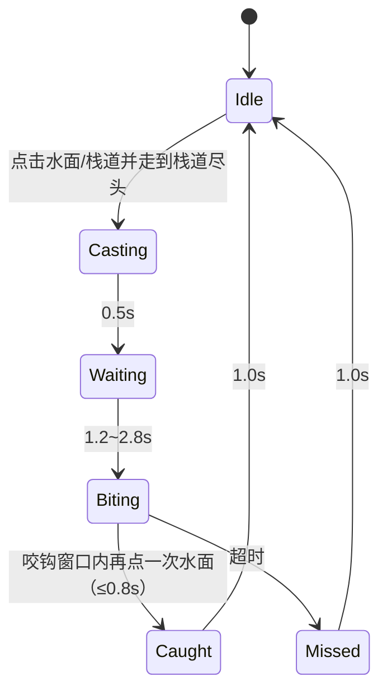
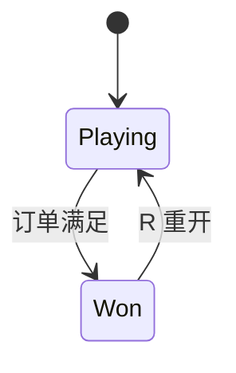
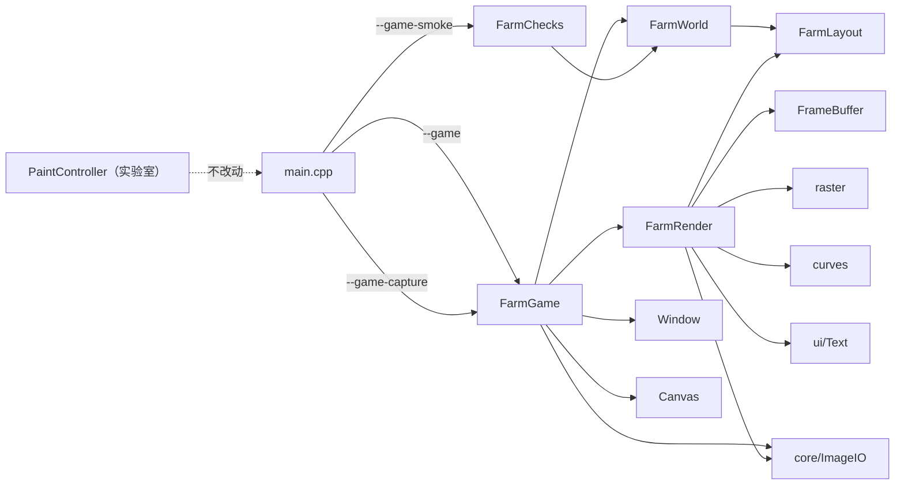

# 期末项目设计稿：胖龙农场（暂定名）

> 状态：设计稿 v0.2（2026-10-18）；**M1 地图/移动已实现**（[#64](https://github.com/zmdld11/SHU-Computer-Graphics/issues/64)），种植/钓鱼待做。  
> 关联 issue：[#63](https://github.com/zmdld11/SHU-Computer-Graphics/issues/63)（总设计）、[#64](https://github.com/zmdld11/SHU-Computer-Graphics/issues/64)（M1 地图）  
> 内部工作名：奶龙农场。对外材料建议使用《胖龙农场》，角色为自绘抽象胖龙，不使用官方奶龙图片或素材。  
> 一句话：基于自研二维绘图引擎的俯视农场小游戏——左边种田，右边钓鱼，完成订单。

---

## 0. 先看结论

| 项目 | 结论 |
|---|---|
| 类型 | 2D 俯视农场小游戏，不是动画短片 |
| 视角 | **地图垂直俯视**（轴对齐格子），角色是**正面 2D 立绘**；不做 2.5D/等距 |
| 场景 | **1536×1152 可滚动地图**：左侧 4×3 农田，右侧椭圆池塘，木栈道与土路 |
| 核心循环 | 选种子 → 播种 → 浇水 → 收获；池塘钓鱼；完成订单 |
| 操作 | **全鼠标点选**：点地面移动，点农田/池塘自动走到交互点 |
| 网格 | **32px 最小格**；农田 3×3 格；角色始终停在格心；先横后竖，受阻 BFS |
| 镜头 | 角色尽量居中；到世界边缘后镜头 clamp，改由角色偏离中心 |
| 目标时长 | 3~5 分钟可完整演示，`R` 可重开 |
| 技术底座 | 复用现有 `cg-labs` 引擎（实验一~四） |
| 新增模块 | `src/game/`，独立 `--game` / `--game-capture` / `--game-smoke` |
| 美术 | 纯矢量图元，2× 超采样后降采样，自绘抽象胖龙，无外部图片/字体/音频 |
| 明确不做 | 奶茶店、商店、NPC、多地图、背包格子、存档、菜单、联网 |

这份文档同时作为：

1. 第 6 周选题汇报的依据；
2. 期末报告“程序结构设计 / 关键算法”章节的底稿；
3. 组内分工和验收的统一口径。

---

## 1. 为什么做这个

### 1.1 从动画到游戏的调整

最初的方案是《奶龙奶茶店》二维动画。动画的优点是算法映射直观、工期可控；缺点是现场只能播放，互动性弱，而且“奶茶店”主题需要额外的分镜和叙事设计。

老师明确说过期末项目**不一定局限于小动画视频**。农场游戏更符合“可现场演示”的方向：

- 观众能自己走两步、种一棵、钓一条鱼，参与感比播放视频强；
- 玩法天然对应状态机和交互，能展示实验三/四的变换与曲线，而不只是播放关键帧；
- 仍然可以保留“抽象搞笑”的基调：胖龙一本正经地种白菜、钓小鱼，本身就有点好笑。

代价是工程量约为动画的 2 倍。因此本设计从第一天就锁定**最小闭环**，把“完整星露谷”砍到一张地图两玩法。

### 1.2 课程约束

- 所有光栅化算法必须手写，不引入第三方图形/界面框架；
- 项目必须建立在同一个程序框架上；
- 期末项目占程序分 50，报告分 50；
- 最终要交源码、报告 PDF、演示录屏和纸质报告。

本设计不新增任何第三方依赖，游戏只复用现有引擎的 `FrameBuffer`、`raster`、`curves`、`geom`、`Text`、`Canvas`、`Window`。

### 1.3 设计目标

1. **可玩**：不看说明也能在 30 秒内明白“种田、钓鱼、交订单”。
2. **可讲**：每个玩法都能指出用了哪节课的算法，而不是纯游戏逻辑堆砌。
3. **可完成**：4 个人在 11 月前能做出完整闭环，而不是一个功能很多但每块都浅的 demo。
4. **可扩展**：如果时间富裕，能加粒子、天气、更多作物；如果时间紧，可以砍到“种植 + 收获 + 钓鱼”。

---

## 2. 范围

### 2.1 做什么

- 一张 1536×1152 的俯视地图：左侧农田、右侧池塘、中间土路与木栈道；
- 全鼠标点选：点击地面下达移动命令，点击农田/池塘自动走到交互点；
- 32px 网格移动：L 形路径优先，被池塘/边界挡住时 BFS 绕行，停在格心；
- 镜头跟随角色，到世界四边后 clamp；窗口最小 800×600；
- 12 块农田，三种作物：白菜、番茄、胡萝卜；
- 播种、浇水、生长、收获四个动作；
- 池塘钓鱼：抛竿、等待、咬钩、收竿；
- 订单板：集齐指定数量的作物和鱼即胜利；
- 胜利结算：显示用时，`R` 重开；
- 视觉反馈：走路 bob、收获 squash、水波、粒子、咬钩提示；
- 无窗口自测 `--game-smoke`，覆盖玩法状态机和碰撞。

### 2.2 不做什么

| 不做 | 原因 |
|---|---|
| 奶茶店/制作台 | 用户明确砍掉；订单板已经能提供目标 |
| 商店/金币/买卖 | 需要额外经济系统和 UI，收益低 |
| NPC/对话 | 需要剧情、对话系统和更多美术，工期风险高 |
| 多地图/场景切换 | 一张可滚动地图足够演示，多地图会稀释算法展示 |
| 背包格子/拖拽 | HUD 直接显示数量，避免做一套物品系统 |
| 存档/读档 | 3~5 分钟一局，不需要 |
| 标题菜单/设置 | 启动即玩，`R` 重开，ESC 退出 |
| 音频 | 无第三方依赖，且不是课程重点 |
| 联网/排行榜 | 与课程无关 |

### 2.3 成功标准

- 第一次玩的同学能在 1 分钟内种下第一棵作物；
- 3~5 分钟内能完成一次订单；
- 答辩时能现场玩，不崩、不卡、不出现“不知道怎么操作”；
- 报告里每个玩法都能对应到具体算法和实验章节。

---

## 3. 创意与美术

### 3.1 基调

**“一本正经地种白菜。”**

- 世界是正常的农场：土块、栅栏、池塘、芦苇；
- 作物是普通蔬菜：白菜、番茄、胡萝卜；
- 主角是一只表情呆滞、身体圆润的抽象胖龙；
- 钓鱼钓上来的就是普通小鱼；
- 幽默来自胖龙的表情和动作，不靠网络梗。

### 3.2 自绘抽象胖龙

不直接使用官方奶龙图片或素材。保留以下辨识特征，但全部用图元重画：

- 黄橙渐变的身体（用 2~3 层实色椭圆叠出层次，不做 alpha 渐变）；
- 梨形/水滴形身体，奶白色肚皮；
- 两只大眼睛、黑色瞳孔、橙色腮红；
- 短手短脚、小翅膀、尾巴（末端奶油色尾尖）；
- 表情呆滞，走路时上下 bob，收获时压扁再弹回。

绘制拆解：

| 部位 | 图元 |
|---|---|
| 身体 | 大椭圆 + 深色描边 |
| 肚皮 | 奶白色椭圆，略小、偏下 |
| 头 | 椭圆，和身体部分重叠 |
| 眼睛 | 白色圆 + 黑色瞳孔 + 高光点 |
| 腮红 | 橙色小椭圆 |
| 嘴 | 二次 Bezier 采样折线 |
| 手脚 | 小椭圆，走路时交替摆动 |
| 翅膀 | 五边形/椭圆，收在身体后侧，向外展开 |
| 尾巴 | 串联椭圆 + 四边形尾尖，走路时轻摆 |

所有部位通过局部矩阵 `translate(玩家位置) · scale(sx, sy)` 组合，天然支持朝向翻转和 squash。

### 3.3 场景

- **农田**：12 张 3×3 格（96×96）的土床直接铺在草地上，块间留 32px 草缝；土色随浇水变深；
- **池塘**：椭圆水面，左上浅、右下深的两色渐变，沿岸芦苇/石头/荷叶，左侧伸入水的木栈道；
- **土路**：由重叠椭圆叠出的不规则土路，从农田下方通到栈道，不再是一条直边浅色带；
- **树林边界**：外圈约 29 棵树把可玩区框住；草丛/花/蘑菇/石头用确定性哈希散落；
- **HUD**：左上木牌标题 + 底部三个种子槽（鼠标点选或 `1/2/3`）。

### 3.4 版权与合规

- 仓库是公开的，最终还要上传超星；因此**不使用官方奶龙图片、Logo、字体或音频**；
- 角色是“自绘抽象胖龙”，外形只保留圆润、黄橙、大眼等通用特征；
- 对外材料统一用《胖龙农场》；内部文档可以写“奶龙农场”作为工作名；
- 所有图形由 `FrameBuffer` 的 `putPixel` 和手写算法生成，符合课程“算法手写”的要求；
- 不引入 Qt/MFC/ImGui/WebView，不引入图片解码库。

---

## 4. 核心循环

```text
        选种子（底部种子槽 / 1·2·3）
                    │
                    ▼
  点击一块田 ──> 走到田块中心 ──> 空地：播种
                                ├─ 幼苗/生长：浇水
                                └─ 成熟：收获
                    │
                    ▼
              订单进度 +1
                    │
  点击池塘/栈道 ──> 走到栈道尽头 ──> 自动抛竿 ──> 等待咬钩
                                              │
                         咬钩窗口内再点水面 ──> 鱼 +1
                                              │
                                              ▼
                                        订单板全部打勾
                                              │
                                              ▼
                                        胜利 → R 重开
```

一局的目标：

1. 种出 3 份白菜、3 份番茄、2 份胡萝卜；
2. 钓到 3 条鱼；
3. 订单板全部打勾，显示用时。

玩家可以自由决定先种田还是先钓鱼；没有强制顺序。农田有 12 块，订单只需要 8 份作物，留出试错空间。**移动和交互都由鼠标发起**，键盘只保留选种子、重开和退出。

---

## 5. 操作

| 输入 | 功能 | 说明 |
|---|---|---|
| 左键点地面 | 移动 | 走到点击格的中心；先横后竖，被水/边界挡住时 BFS 绕行 |
| 左键点农田 | 农田互动 | 走到该田块中心；到达后按状态自动播种 / 浇水 / 收获 |
| 左键点水面或栈道 | 钓鱼 | 走到栈道尽头；到达后自动抛竿，咬钩窗口内再点一次水面收竿 |
| 右键 | 取消 | 取消当前移动；钓鱼/结算面板打开时关闭面板 |
| 底部种子槽 / `1` `2` `3` | 选种子 | 白菜 / 番茄 / 胡萝卜；选中的槽上浮并描金边 |
| `R` | 重开 | 任意时刻重置本局（回到出生点、清空农田） |
| `ESC` | 退出 | 由 `Window` 统一处理 |

交互规则：

- 角色只停在格心。移动中再次点击，会从当前所在格重新寻路；
- 农田的交互点是田块中心格；鼠标悬停整块田时显示金色边框；
- 池塘的交互点是栈道尽头的格子；悬停水面/栈道时显示格角 + 小鱼图标；
- 空地到达：种下当前选中种子；幼苗/生长中到达：浇水（每个阶段一次）；成熟到达：收获；
- 钓鱼到达后自动抛竿；`Casting/Waiting/Biting` 期间角色不能移动；
- M1 已实现点选移动、路径、悬停、镜头；播种/浇水/钓鱼在 M2/M3 接入。

---

## 6. 世界布局

### 6.1 世界坐标与窗口

游戏逻辑固定使用 **1536×1152 世界坐标**（48×36 个 32px 格），窗口只决定“镜头看到哪一块”：

- 窗口初始/最小 800×600，世界比窗口大，因此镜头会滚动；
- 鼠标坐标 → 世界坐标：`world = screen + cameraTopLeft`；
- HUD 用屏幕坐标绘制，不参与世界滚动；
- 世界坐标不随窗口缩放，窗口变大只是看到更多地图；
- 鼠标事件已由 `Window` 从逻辑坐标换算到 framebuffer 像素，高 DPI 不额外处理。

### 6.2 布局示意

```text
┌────────────────────────────────────────────────────────────┐ 0
│ 树林（不可行走的装饰边界）                                   │
│                                                            │
│    ┌──┬──┬──┬──┐                          .-~~~~~~~-.      │
│    │田│田│田│田│                         /   池塘    \     │
│    ├──┼──┼──┼──┤                        (  渐变水面   )    │
│    │田│田│田│田│                         \           /     │
│    ├──┼──┼──┼──┤                          `-~~~~~~~-'      │
│    │田│田│田│田│                              ┃            │
│    └──┴──┴──┴──┘────────土路──────────────┛栈道           │
│                        出生点                               │
│ 树林（不可行走的装饰边界）                                   │
└────────────────────────────────────────────────────────────┘ 1152
```

### 6.3 关键坐标

| 元素 | 数值 |
|---|---|
| 世界尺寸 | 1536 × 1152 |
| 最小格 | 32 × 32 |
| 世界格数 | 48 列 × 36 行 |
| 可行走范围 | 格 `col 6..41, row 6..29`（像素 `x 192..1344, y 192..960`） |
| 农田行列 | 4 列 × 3 行 = 12 块 |
| 单块农田 | 96 × 96（3×3 格），块间距 32px（1 格） |
| 农田总范围 | `x 160..640, y 256..608` |
| 池塘中心 | `(1120, 576)` |
| 池塘椭圆半径 | `rx=192, ry=224` |
| 木栈道 | 格 `col 27..31, row 19..20`，尽端 `(31,20)` = 像素 `(1008,656)` |
| 土路 | `y 608..672`，从农田下方通到栈道 |
| 出生点 | 格 `(20,20)` = 像素 `(656,656)` |
| 玩家速度 | 220 px/s |
| 玩家视觉半径 | 约 16（碰撞按格判定，不做圆-水连续碰撞） |
| 镜头视口 | 窗口 framebuffer 尺寸，最小 800×600 |
| 镜头平滑 | `1 - exp(-9·dt)` |
| 交互点 | 农田 = 田块中心格；池塘 = 栈道尽端格 |

> 这些值集中放在 `FarmLayout.hpp`，逻辑、渲染、鼠标命中测试共用同一份常量。

### 6.4 镜头

- 目标：`target = clamp(player - viewport/2, 0, world - viewport)`；
- 每帧平滑：`camera += (target - camera) · (1 - exp(-9·dt))`；
- 角色在世界内部时尽量居中；到左/上/右/下边界后镜头停住，角色在屏幕内偏离中心继续走；
- 窗口大于世界时镜头固定为 0，多出来的区域填深草色；
- 鼠标点击用**当前帧镜头**换算世界坐标，因此滚动过程中点选仍然准确。

---

## 7. 规则与状态机

### 7.1 作物



点击田块后角色先走到田块中心格；到达时按当前阶段自动执行：空地播种、幼苗/生长中浇水、成熟收获。移动过程中角色不能隔空操作农田。

每块农田保存：

| 字段 | 含义 |
|---|---|
| `kind` | 白菜 / 番茄 / 胡萝卜 |
| `stage` | Empty / Seed / Sprout / Mature |
| `age` | 当前累计生长秒数 |
| `watered` | 当前阶段是否已浇水 |

生长规则：

- `Seed` / `Sprout` 阶段每帧 `age += dt × (watered ? 1.6 : 1.0)`；
- `age ≥ 6s` 进入 `Sprout`，`age ≥ 14s` 进入 `Mature`；
- 进入新阶段时 `watered = false`，可以再浇一次；
- 浇水只对当前阶段生效一次，同一阶段重复点击不叠加；
- 成熟收获后 `age = 0`、`watered = false`、`stage = Empty`；
- 种子无限，不消耗库存，避免引入商店。

### 7.2 钓鱼



规则：

- 只有 `Idle` 且角色已走到栈道尽头时，才开始抛竿；点击水面会自动先寻路；
- 抛竿目标点在池塘内部随机取，用二次 Bezier 从竿尖到目标点采样 24 段，0.5 秒内推进；
- `Waiting` 阶段鱼漂做正弦轻微上下，等待时间随机 1.2~2.8 秒；
- `Biting` 阶段鱼漂下沉，HUD/头顶出现“咬钩！”提示，窗口 0.8 秒；
- 窗口内左键再点一次水面：成功，鱼 +1；
- 窗口超时：`Missed`，1 秒后回到 `Idle`；
- `Casting` / `Waiting` / `Biting` 期间玩家不能移动，防止“边跑边钓”；
- 钓鱼线和抛竿路径使用 Bezier，既好看，也能在报告里对应实验四。

### 7.3 订单与胜利

默认订单：

| 物品 | 需求 |
|---|---|
| 白菜 | 3 |
| 番茄 | 3 |
| 胡萝卜 | 2 |
| 鱼 | 3 |

- 库存四个计数器：`cabbage / tomato / carrot / fish`；
- 每次库存变化后检查 `inventory >= order`；
- 满足后进入 `Won`，停止更新，显示胜利面板和用时；
- `R` 任意时刻重开；胜利后也可以 `R`；
- 订单数值是默认值，试玩后如果节奏偏慢可以降到 2/2/1/2。

### 7.4 游戏阶段



`Playing` 时更新玩家、作物、钓鱼和计时；`Won` 时冻结世界，只保留重开输入。

---

## 8. 数值表

| 参数 | 默认值 | 备注 |
|---|---|---|
| 世界尺寸 | 1536 × 1152 | 48×36 个 32px 格 |
| 最小格 | 32 × 32 | 停步/寻路单位 |
| 玩家速度 | 220 px/s | 沿路径段匀速 |
| 玩家视觉半径 | 16 | 仅绘制/阴影，不参与碰撞 |
| 农田 | 96 × 96 / 块 | 3×3 格，块间距 1 格 |
| 镜头平滑 | 9 /s | `1 - exp(-9·dt)` |
| 播种→幼苗 | 6s | 受浇水倍率影响 |
| 播种→成熟 | 14s | 总时长 |
| 浇水倍率 | 1.6× | 仅当前阶段 |
| 抛竿动画 | 0.5s | Bezier 推进 |
| 等待咬钩 | 1.2~2.8s | 随机 |
| 咬钩窗口 | 0.8s | 鼠标点击水面 |
| 成功/失败提示 | 1.0s | 回到 Idle |
| 订单 | 3/3/2/3 | 白菜/番茄/胡萝卜/鱼 |
| 粒子上限 | 200 | 防止无限增长 |
| 目标帧率 | 60 FPS | vsync 已开启 |

所有数值集中管理，不散落在渲染代码里；调参时只改一处。

---

## 9. 技术架构

### 9.1 模块划分

```text
src/game/
├── FarmLayout.hpp      世界 48×36 格、农田/池塘/栈道、可行走判定、HUD 布局
├── FarmWorld.hpp/.cpp  纯逻辑：格点移动（L 形 + BFS）、镜头、悬停、农田数据
├── FarmRender.hpp/.cpp 矢量渲染：2× 背景烘焙、相机窗口拷贝、胖龙、作物、池塘、HUD
└── FarmGame.hpp/.cpp   窗口/画布/输入/主循环/--game-capture
src/core/
└── ImageIO.hpp/.cpp    PPM 导出（游戏截图与 --demo 共用）
src/tests/
├── FarmChecks.hpp/.cpp --game-smoke（无窗口）
```

入口：`src/main.cpp` 编译成 `cg-engine`（编辑器 + 所有命令行模式）；
`src/game_main.cpp` 编译成 `farm-game`（直接进游戏，CLion 里选这个目标即可）。
两个入口链接同一个 `cg-engine-lib` 静态库，源码只编译一遍。

职责边界：

| 模块 | 负责 | 不负责 |
|---|---|---|
| `FarmLayout` | 常量、格中心/田块矩形、可行走/池塘判定、HUD 命中 | 状态、渲染 |
| `FarmWorld` | M1：玩家、L/BFS 路径、镜头、悬停、农田数据；M2/M3 接作物/钓鱼/订单 | 任何像素绘制 |
| `FarmRender` | 所有矢量绘制、2× 超采样背景缓存、胖龙、HUD | 修改玩法状态 |
| `FarmGame` | 窗口、鼠标/键盘输入、dt、主循环、截图 | 具体规则/绘制细节 |
| `FarmChecks` | 无窗口断言 | 窗口/GL |

### 9.2 依赖关系



关键约束：

- `FarmWorld` 不 include `raster/ui`，保证可以无窗口测试；
- `FarmRender` 只读 `FarmWorld` 的公开状态和 `crop()`，不反过来改逻辑；
- `FarmGame` 是唯一接触 `Window`/`Canvas` 的游戏模块；
- **`PaintController` 一行不改**，实验室的 186 项 smoke 不受影响；
- 游戏模块不依赖 `PaintController`，避免把编辑器状态机搅进游戏。

### 9.3 程序入口

`main.cpp` 增加三个早退分支，放在现有 `--smoke` 之前：

- `--game`：启动游戏窗口；
- `--game-capture`：无窗口渲染 `game-background.ppm`（纯背景）/ `game-world.ppm` / `game-pond.ppm` / `game-farm.ppm`（美术评审/报告插图）；
- `--game-smoke`：无窗口跑农场自测，返回 0/1。

另外提供 `farm-game` 可执行目标（`src/game_main.cpp`）：CLion 运行配置里直接选它，
不需要填 Program arguments；命令行 `./build/farm-game` 等价于 `cg-engine --game`。

现有 `--demo`、`--demo-ui`、`--stress-ui`、`--bench-ui`、`--smoke` 全部保持不变。

### 9.4 主循环

```text
pollEvents（鼠标移动/左右键/1·2·3/R/ESC）
  ↓
计算 dt（steady_clock，上限 0.05s）
  ↓
FarmWorld.update(dt)        // 沿路径段移动、镜头平滑
  ↓
更新悬停（屏幕坐标 + 当前镜头 → 世界坐标）
  ↓
FarmRender.frame(fb, world) // 世界缓存 → 视口；悬停；胖龙；HUD
  ↓
Canvas.present(fb) → Window.swapBuffers
```

- 输入只在事件回调里处理：左键按下时判断是否点中 HUD 种子槽，否则 `world.onClick()`；
- 没有键盘按住状态；移动完全由路径驱动；
- 窗口 resize 时同步 `fb.resize`、`canvas.resize`、`world.setViewport`；
- 最小化产生 0×0 时跳过渲染；
- ESC 仍由 `Window` 直接退出。

### 9.5 对现有代码的加法

- `Window::setMinSize`：游戏启动时设 800×600，避免 HUD 被压扁；编辑器不调用；
- `FrameBuffer::copyRectFrom`：按镜头位置从世界缓存整块拷贝，自动夹边界；
- `core/ImageIO`：把 PPM 导出从 tests 抽到 core，游戏截图与 `--demo` 共用；
- CMake 拆分 `cg-engine-lib` 静态库 + `cg-engine`/`farm-game` 两个入口，源码只编译一遍；
- `--smoke` 增加 1 项 `copyRectFrom` 断言（185 → 186）。

`PaintController`、实验室交互、已有测试路径均不改；`--demo` 输出与改动前逐字节一致。

---

## 10. 渲染设计

### 10.1 分层

每帧只做三件事：

1. **世界层**：按镜头位置从 `background_` 整块拷贝一块视口（`copyRectFrom`），不重画场景；
2. **动态层**：胖龙、悬停金边/鱼图标；M2/M3 再叠加作物动效、鱼漂/鱼线、粒子；
3. **UI 层**：左上标题木牌 + 底部种子槽；M2 再加订单板和计时。

静态背景只在启动时烘焙一次；窗口 resize 只改视口大小，不重建世界缓存。

### 10.2 背景缓存与 2× 超采样

世界缓存固定 **1536×1152**，与窗口尺寸无关：

- 在 **3072×2304** 的临时 `FrameBuffer` 上按 2× 坐标画全部静态内容；
- 逐 2×2 取均值降采样到 1536×1152；
- 内容：草地色块、12 张土床、池塘、木栈道、土路、树林边界、花草/石头/蘑菇；
- 烘焙一次（Release 约 0.15s，Debug 约 0.25s），之后每帧只做一次整块行拷贝。

2× 超采样让中点圆、扫描线填充、椭圆渐变在最终 1× 图上有干净边缘，同时不引入 alpha 或第三方库。

### 10.3 HUD

当前 M1 的 HUD：

- 左上木牌：小胖龙头像 + “胖龙农场”；
- 底部三个种子槽：白菜/番茄/胡萝卜图标，选中的槽上浮、金边、指针。

HUD 用屏幕坐标绘制，不随世界滚动。M2 加入订单四项和计时后，再按“库存/选种/钓鱼状态/胜利/秒数”指纹缓存，避免每帧重排文字。

### 10.4 椭圆与水面

- 一般实心椭圆：按参数方程取 24~48 个顶点，交给实验二的 `scanlineFillPolygon`；
- 描边：相邻顶点用 `drawLine` 连线，形成 1~2px 深色轮廓；
- 池塘水面：椭圆内逐扫描线求半宽，逐像素按“左上→右下”的 `t` 在浅蓝和深蓝之间插值，得到无硬色带的渐变；
- 池塘边缘：浅色沙岸 + 深色湿沙 + 深蓝水岸线；荷叶/芦苇/鱼影画在水面之上。

水面渐变仍是手写光栅：行循环 + 椭圆半宽 + 颜色插值，没有图片或着色器。

### 10.5 胖龙

- 正面 2D 立绘（billboard），不是 3D 模型：身体、肚皮、头、眼睛、腮红、手脚、翅膀、尾巴都是椭圆/多边形；
- 嘴是二次 Bezier；翅膀是五边形，尾尖是四边形；
- 局部坐标按朝向左/右翻转（`x` 乘 ±1）；走路时整体 `sin` 上下 bob；
- 阴影取脚下背景色并压暗（不做 alpha），因此草地、土路、木栈道上阴影颜色都正确；
- M2 收获时做 squash & stretch，M3 钓鱼时前倾/抬手。

### 10.6 场景细节

- 土床：深土色不规则边 + 土面；短而错落的垄沟、土块、碎屑；浇水后土色变深并出现水光短线；
- 作物：白菜（外层深绿叶 + 浅色菜心）、番茄（主茎 + 三颗红果 + 萼片）、胡萝卜（橙色根肩 + 羽状叶）；种子/幼苗/成熟三态；
- 土路：一串重叠椭圆叠出不规则土路，浅色土斑 + 断续车辙 + 路缘草；
- 池塘：渐变水面、沙岸、荷叶、芦苇、石头、两条鱼影；
- 栈道：木板、四根桩、尽头一盏暖色小灯；
- 树林：29 棵分层树冠的树围住可玩区，树冠带高光、树干带阴影；
- 粒子：M4 再加，上限 200。

### 10.7 视觉原则

- 不使用 alpha 混合：`FrameBuffer` 没有透明通道，所有叠加用实色覆盖；
- 胜利面板用不透明深色板 + 边框，不依赖半透明；
- 主色控制在 10 个左右：草绿、土棕、沙色、水蓝、木色、奶白、黄橙、深灰；
- 所有主体形状有 1~3px 深色描边，保证投影仪/录屏里也看得清；
- 静态背景 2× 超采样，动态角色保持 1×，避免每帧重绘整个场景。

---

## 11. 玩法 → 课程算法映射

| 玩法 / 效果 | 课程算法 | 对应实验 |
|---|---|---|
| 农田土床、池塘边缘、胖龙、作物、栈道的实心区域 | 扫描线多边形填充（NET + AET） | 实验二 |
| 眼睛、番茄、水波、圆形粒子、种子槽图标 | 中点圆 / Bresenham 直线 | 实验一 |
| 格点移动与路径 | 32px 网格；优先先横后竖的 L 形，水/边界挡住时 4 邻域 BFS | 自定（图搜索） |
| 池塘不可行走、栈道可行走 | 椭圆方程 + 格中心判定 + 栈道格覆盖 | 实验一/三延伸 |
| 镜头跟随与边界 | 视口矩形 clamp + 指数平滑 | 实验三延伸 |
| 胖龙局部动画、朝向翻转、squash | 2D 平移/缩放矩阵 | 实验三 |
| 钓鱼抛竿路径、鱼线、嘴部曲线 | 二次 Bezier / 采样折线 | 实验四 |
| 作物生长、咬钩窗口、提示淡出 | 时间轴 + 缓动 | 自定 / 动画十二原则 |
| 收获压扁、上钩抖动 | squash & stretch | 动画十二原则 |
| 世界背景 2× 超采样 + 2×2 均值降采样 | 图像重采样（工程优化） | 实验二延伸 |
| 背景缓存 + 相机窗口拷贝 | 提交层/显示层缓存（工程优化） | 实验二延伸 |
| 水面椭圆渐变 | 椭圆扫描 + 颜色线性插值 | 实验二延伸 |
| 文字与 HUD | 系统字体栅格化 + 自绘 UI | 实验三延伸 |

报告里可以进一步对应动画十二原则：

- **Squash & stretch**：胖龙收获、鱼漂下沉；
- **Anticipation**：抛竿前的短暂蓄力；
- **Follow-through**：鱼线余摆、粒子；
- **Easing**：抛竿/咬钩提示；
- **Staging**：HUD 订单板、农田高亮；
- **Secondary action**：水波、芦苇、胖龙尾巴；
- **Timing**：生长 6s/14s、咬钩 0.8s。

---

## 12. 测试与验收

### 12.1 无窗口自测 `--game-smoke`

M1 已实现 22 项断言：

- 出生点在格心、出生格可行走；
- 池塘中心不可行走、栈道尽头可行走、世界边界外不可行走；
- 左上田块索引正确；
- 点击生成路径，L 形先横后竖，目标为格心；
- 走完后角色停在格心、`moving == false`；
- 点水面目标换成栈道尽头，悬停类型为 `Pond`；
- 从池塘上方点水，L 形受阻时 BFS 能找到路，所有拐点可行走；
- 点农田目标为田块中心；
- 镜头左上/右下边界 clamp；
- 重开清空农田、复位选种、回到出生点。

M2/M3 再补：播种→幼苗→浇水→成熟→收获、钓鱼状态机、订单判定、`Won`/`R`、渲染冒烟。

### 12.2 现有回归

- `--smoke` 186 项保持全绿（新增 `copyRectFrom` 断言）；
- `--stress-ui` 不崩；
- `--demo` 输出与改动前**逐字节一致**（实验室渲染路径未变）；
- `--game-capture` 能输出 1536×1152 全图与两张 800×600 视角图。

### 12.3 构建矩阵

| 配置 | 要求 | 2026-10-18 结果 |
|---|---|---|
| MinGW Release | 无警告，游戏可跑，`--game-smoke` 全绿 | 通过 |
| MinGW Debug（-Og + 断言） | 无警告，`--game-smoke` 全绿 | 通过 |
| MSVC Debug + ASan | 无警告，`--game-smoke`/`--game-capture` 通过 | 通过 |

### 12.4 手动验收清单（M1）

- [ ] `--game` 启动，窗口最小 800×600，地图直接可见；
- [ ] 点地面：角色按先横后竖走到格心；
- [ ] 点农田：角色走到田块中心，悬停时整块田金边；
- [ ] 点水面：角色走到栈道尽头，悬停时格角 + 鱼图标；
- [ ] 移动中再点：从当前格重新寻路，不抖动；
- [ ] 镜头跟随；走到世界四边时镜头停住、角色偏移；
- [ ] 拖大/缩小窗口，HUD 固定在四角/底部，不重叠；
- [ ] 角色不能走进池塘、不能走出可行走范围。

M2/M3 追加：12 块田都能播种/浇水/收获、三种作物可区分、钓鱼成功/失败、订单/胜利面板、`R` 重开、连续玩 5 分钟不崩不卡。

---

## 13. 分工与里程碑

### 13.1 四人分工（建议）

| 角色 | 负责 | 交付 |
|---|---|---|
| 组长（仓库主管） | 总体架构、`FarmGame` 主循环、整合、PPT 统稿、对外汇报 | 可运行主程序、PPT、最终整合 |
| 成员 A | `FarmWorld` 玩法逻辑：作物、订单、碰撞、状态机 | 规则实现 + `FarmChecks` 逻辑断言 |
| 成员 B | `FarmRender` 场景/胖龙/作物/池塘、背景与 HUD 缓存 | 视觉可演示的画面 |
| 成员 C | 钓鱼小游戏、粒子/动效、录屏与报告素材、试玩 QA | 钓鱼可用、演示视频、测试记录 |

> 具体姓名按组内实际情况填；如果某位同学更擅长美术/文档，可以互换 B/C 的部分职责。

### 13.2 里程碑

| 时间 | 目标 | 验收 |
|---|---|---|
| 第 6 周（选题汇报） | 6 页 PPT（已完成，16:9，含讲稿）+ **M1 已完成（2026-10-18）**：可滚动地图、格点移动、镜头、悬停、胖龙/农田/池塘美术 | `--game` 可走、`--game-capture` 四张预览图（含纯背景） |
| 第 7 周 | M2 种植闭环：播种/浇水/收获、HUD、订单板 | 能种出第一份作物，订单进度变化 |
| 第 8 周 | M3 钓鱼：抛竿/等待/咬钩/收竿、粒子 | 能钓到鱼，成功/失败都有反馈 |
| 第 9 周 | M4 收尾：胜利/重开、squash、波纹、`--game-smoke` | 完整 3~5 分钟一局 |
| 第 10 周 | 报告、录屏、试玩 QA、最终修复 | 提交材料齐全 |
| 11 月 | 统一验收/提交 | 源码 + 报告 PDF + 录屏 + 纸质报告 |

### 13.3 每周同步

- 周一：确认本周目标与分工；
- 周三：中间检查，优先解决“卡住”的问题；
- 周五：合并到 `feat/farm-game`（M1 用 `feat/farm-map`），更新 issue #63/#64 的过程记录；
- 每次合并前跑 `--smoke`、`--game-smoke` 和 `--game-capture`。

---

## 14. 风险与止损

| 风险 | 影响 | 应对 / 止损 |
|---|---|---|
| 范围失控（想加商店/NPC） | 做不完 | 本设计明确不做；新增功能必须替换现有功能，不叠加 |
| 钓鱼手感差 | 演示效果差 | 退化为“咬钩提示 + 0.8s 按键窗口”，不再加复杂条 |
| 美术耗时 | 画面粗糙 | 优先胖龙、作物、池塘三样；花草/栅栏可减 |
| 文字每帧重绘卡顿 | 帧率下降 | HUD 缓存，只在状态变化时重画 |
| 窗口 resize/高 DPI | 布局错位 | 世界坐标 + 镜头 clamp；HUD 用屏幕坐标；最小窗口 800×600 |
| 键盘焦点丢失 | 按键卡住 | 失焦时清空按住状态（如能拿到焦点回调；否则重开/退出兜底） |
| 粒子无限增长 | 内存/性能 | 上限 200，按生命周期回收 |
| IP 争议 | 公开仓库/超星风险 | 自绘抽象胖龙，不用官方素材；对外名《胖龙农场》 |
| 游戏影响实验室代码 | 课程验收风险 | 独立 `src/game/` + `--game`，`PaintController` 零改动 |

**止损顺序**：先保“种植→收获→钓鱼→订单”闭环，再保胖龙/作物/池塘视觉，最后才做粒子、震屏、额外作物。

---

## 15. 第 6 周 PPT（6 页）

实际汇报结构（16:9，含讲稿备注，约 3.3 分钟；正文不小于 24pt，注释不小于 20pt；纯白背景）：

1. **封面**：胖龙农场 / 计算机图形学课程项目 / 第 6 周选题汇报。
2. **项目介绍**：左边 12 块农田，右边 1 个池塘；种白菜、番茄、胡萝卜，也可以钓鱼；完成订单，一局结束；目标 3 到 5 分钟。
3. **场景布置**：草地和光斑、土路、4×3 共 12 块农田、池塘和木栈道、树木花草；只放纯背景，不含角色和界面。
4. **操作逻辑**：左键点格子；先横后竖走 L 形；停在格子中间；到农田种地、到栈道钓鱼；右键取消；镜头跟随与边界处理。
5. **场景绘制**：背景由六层元素叠成（草地、土路、农田、池塘与栈道、花草石头、树木）；放映时点击一次，六层依次淡入；整张背景只在启动时合成一次，之后每帧只拷贝相机窗口。
6. **进度安排**：第 6 周地图、点选移动、镜头已完成；第 7 周种植；第 8 周钓鱼；第 9 周订单、胜利和收尾。

> 版式沿用旧 PPT 的“大字 + 左文右图”结构，底色改为纯白；标题用“项目介绍/场景布置/操作逻辑/场景绘制/进度安排”，不用抒情标题；不用圆角卡片、徽章、胶囊标签和投影。正文 24pt 起，注释 21pt 起。
>
> 生成流程：本地 `ppt-master` Quick 流程，6 页 SVG → `svg_quality_checker.py` → `animations.json` 校验 → `svg_to_pptx.py` 导出原生 PPTX。场景页使用 `--game-capture` 导出的纯背景和 `game-layer-1..6.ppm`；六张累计帧用 Pillow 做差分，得到带透明通道的图层 PNG；PPT 用原生淡入动画逐层叠加，另导出 `assets/场景图层叠加.gif` 供预览。

---

## 16. 报告章节建议

1. 选题背景与需求分析
2. 总体设计：可滚动世界、核心循环、模块划分
3. 详细设计：作物/钓鱼/订单状态机、碰撞、输入
4. 关键算法：扫描线填充、椭圆/圆、Bezier、矩阵、缓存
5. 动画与交互：十二原则、squash、粒子、HUD
6. 测试与性能：`--game-smoke`、双工具链、帧率
7. 总结与展望：可扩展方向（商店、NPC、多地图）

---

## 17. 待确认项

> v0.2 已定：**地图垂直俯视 + 角色正面 2D 立绘**；**全鼠标点选移动**；**32px 最小格**；**镜头跟随 + 边缘 clamp**。这四项不再作为待确认项。

以下都有默认建议，不阻塞设计；实现前由组内拍板：

| 事项 | 默认建议 | 备选 |
|---|---|---|
| 订单数值 | 3 白菜 + 3 番茄 + 2 胡萝卜 + 3 鱼 | 2/2/1/2（更快） |
| 对外名称 | 《胖龙农场》 | 《奶龙农场》（注意 IP） |
| 四人分工 | 按 13.1 的角色表 | 按实际擅长互换 |
| PPT demo | 录屏 + 现场可玩兜底 | 只录屏 |
| 标题菜单 | 不做，启动即玩 | 加一个简单标题页 |
| 鱼的类型 | 一种通用“鱼” | 2~3 种鱼（只影响表现） |

---

## 附录 A：名词速查（给组员的白话版）

| 名词 | 一句话解释 |
|---|---|
| 状态机 | 把“现在能做什么”拆成几个状态，例如作物只能从种子→幼苗→成熟 |
| 缓存 | 把不变的东西先画好存起来，每帧直接复制，不重新画 |
| AABB | 用一个矩形框住物体，矩形相交就认为碰上了 |
| Bezier | 用几个控制点画一条平滑曲线，钓鱼线和嘴都用它 |
| squash & stretch | 压扁/拉长：收获时胖龙先压扁再弹回，看起来有弹性 |
| 提交层 | 不常变的画面先画好；每帧只叠加会动的部分 |

---

## 附录 B：设计决策记录

| 决策 | 选择 | 理由 |
|---|---|---|
| 游戏还是动画 | 游戏 | 老师允许；现场可玩；交互能展示状态机和变换 |
| 场景范围 | 1536×1152 一张地图（农田 + 池塘） | 4 人 11 月前可完成；避免多地图/商店拖垮工期 |
| 目标 | 订单板 | 不引入经济系统，又能给玩家明确目标 |
| 主角 | 自绘抽象胖龙 | 保留辨识度，规避 IP；纯矢量可实现 |
| 美术 | 纯矢量 | 零外部素材；和引擎能力一致；符合课程要求 |
| 架构 | 独立 `src/game/` + `--game` | 不污染实验室代码；可独立测试 |
| 坐标 | 1536×1152 世界 + 32px 格 + 镜头 | 窗口只决定视口，玩法坐标稳定 |
| 视角 | 垂直俯视 + 正面立绘 | 地图格子与课程算法清晰；等距需要深度排序，纯矢量收益低 |
| 操作 | 全鼠标点选 | 点击即走、到达自动交互；现场演示无需背键位 |
| 网格 | 32px、L 形 + BFS | 停步精确、路径可预期；BFS 处理池塘/边界 |
| 镜头 | 跟随 + 边缘 clamp | 日式 RPG 手感；世界大于窗口 |
| 渲染 | 2× 超采样 + 相机缓存 | 纯矢量边缘干净；每帧只拷贝视口 |
| 渲染 | 背景/HUD 缓存 + 动态层 | 60 FPS 目标；文字不逐帧重排 |
| 透明 | 不用 alpha | FrameBuffer 无透明通道；用实色覆盖 |
| 音频 | 不做 | 无第三方依赖，不是课程重点 |

---

> 下一步：M1 已合入 `feat/farm-map`（issue #64）。接下来做 M2 种植闭环：点击田块到达后自动播种/浇水/收获、订单板与计时；继续不修改 `PaintController`。
