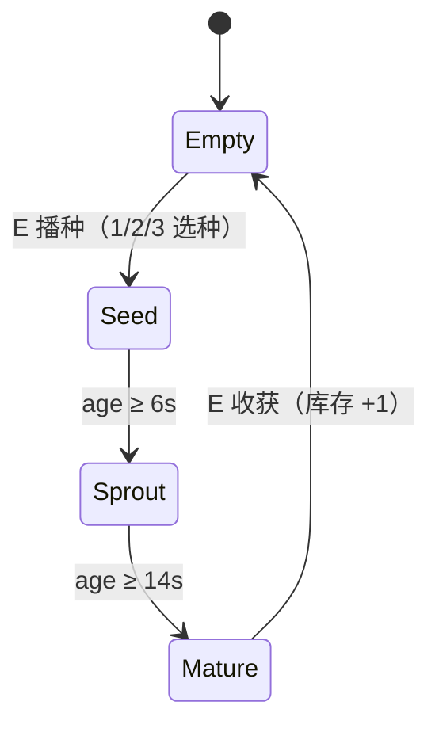
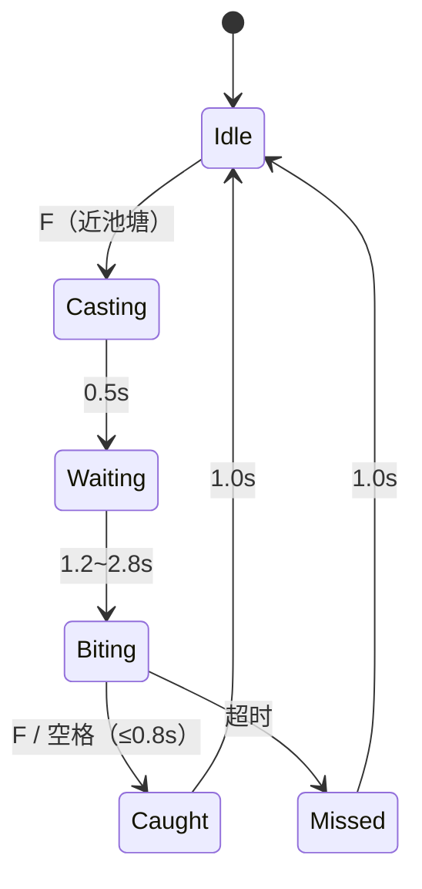
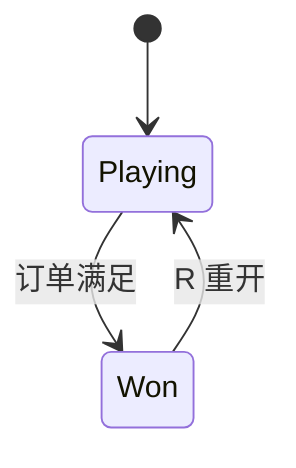
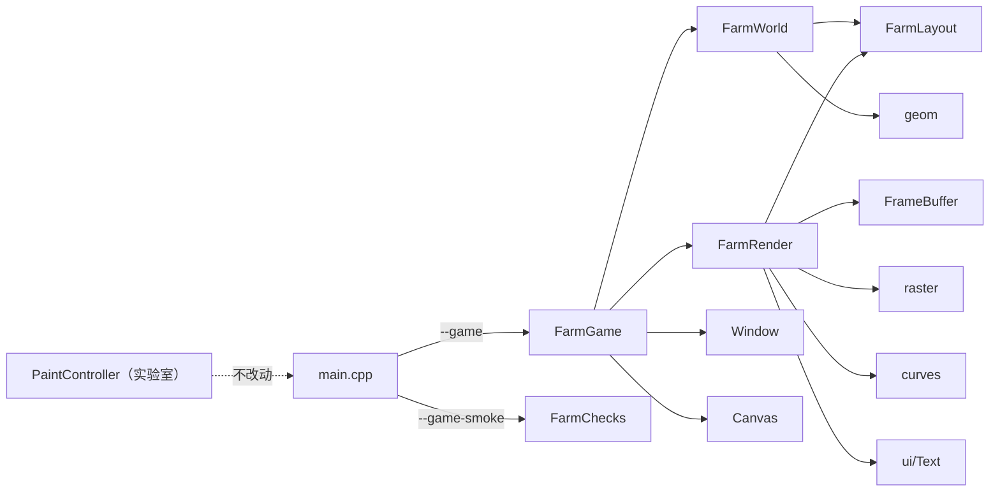

# 期末项目设计稿：胖龙农场（暂定名）

> 状态：设计稿 v0.1（2026-10-18），**尚未实现**。  
> 关联 issue：[#63](https://github.com/zmdld11/SHU-Computer-Graphics/issues/63)  
> 内部工作名：奶龙农场。对外材料建议使用《胖龙农场》，角色为自绘抽象胖龙，不使用官方奶龙图片或素材。  
> 一句话：基于自研二维绘图引擎的一屏农场小游戏——左边种田，右边钓鱼，完成订单。

---

## 0. 先看结论

| 项目 | 结论 |
|---|---|
| 类型 | 2D 俯视农场小游戏，不是动画短片 |
| 场景 | 一屏：左侧 4×3 农田，右侧椭圆池塘，顶部订单板 |
| 核心循环 | 选种子 → 播种 → 浇水 → 收获；池塘钓鱼；完成订单 |
| 目标时长 | 3~5 分钟可完整演示，`R` 可重开 |
| 技术底座 | 复用现有 `cg-labs` 引擎（实验一~四） |
| 新增模块 | `src/game/`，独立 `--game` 模式 |
| 美术 | 纯矢量图元，自绘抽象胖龙，无外部图片/字体/音频 |
| 明确不做 | 奶茶店、商店、NPC、多地图、背包格子、存档、菜单、联网 |

这份文档同时作为：

1. 第 6 周选题汇报的依据；
2. 期末报告“程序结构设计 / 关键算法”章节的底稿；
3. 组内分工和验收的统一口径。

---

## 1. 为什么做这个

### 1.1 从动画到游戏的调整

最初的方案是《奶龙奶茶店》二维动画。动画的优点是算法映射直观、工期可控；缺点是现场只能播放，互动性弱，而且“奶茶店”主题需要额外的分镜和叙事设计。

老师明确说过期末项目**不一定局限于小动画视频**。农场游戏更符合“可现场演示”的方向：

- 观众能自己走两步、种一棵、钓一条鱼，参与感比播放视频强；
- 玩法天然对应状态机和交互，能展示实验三/四的变换与曲线，而不只是播放关键帧；
- 仍然可以保留“抽象搞笑”的基调：胖龙种珍珠、钓椰果，本身就是荒诞但一眼能懂的设定。

代价是工程量约为动画的 2 倍。因此本设计从第一天就锁定**最小闭环**，把“完整星露谷”砍到一屏两玩法。

### 1.2 课程约束

- 所有光栅化算法必须手写，不引入第三方图形/界面框架；
- 项目必须建立在同一个程序框架上；
- 期末项目占程序分 50，报告分 50；
- 最终要交源码、报告 PDF、演示录屏和纸质报告。

本设计不新增任何第三方依赖，游戏只复用现有引擎的 `FrameBuffer`、`raster`、`curves`、`geom`、`Text`、`Canvas`、`Window`。

### 1.3 设计目标

1. **可玩**：不看说明也能在 30 秒内明白“种田、钓鱼、交订单”。
2. **可讲**：每个玩法都能指出用了哪节课的算法，而不是纯游戏逻辑堆砌。
3. **可完成**：4 个人在 11 月前能做出完整闭环，而不是一个功能很多但每块都浅的 demo。
4. **可扩展**：如果时间富裕，能加粒子、天气、更多作物；如果时间紧，可以砍到“种植 + 收获 + 钓鱼”。

---

## 2. 范围

### 2.1 做什么

- 一屏俯视场景：左侧农田、右侧池塘、顶部订单板、底部操作提示；
- 玩家控制一只自绘抽象胖龙，WASD/方向键移动；
- 12 块农田，三种作物：茶叶、珍珠、椰果；
- 播种、浇水、生长、收获四个动作；
- 池塘钓鱼：抛竿、等待、咬钩、收竿；
- 订单板：集齐指定数量的作物和鱼即胜利；
- 胜利结算：显示用时，`R` 重开；
- 视觉反馈：走路 bob、收获 squash、水波、粒子、咬钩提示；
- 无窗口自测 `--game-smoke`，覆盖玩法状态机和碰撞。

### 2.2 不做什么

| 不做 | 原因 |
|---|---|
| 奶茶店/制作台 | 用户明确砍掉；订单板已经能提供目标 |
| 商店/金币/买卖 | 需要额外经济系统和 UI，收益低 |
| NPC/对话 | 需要剧情、对话系统和更多美术，工期风险高 |
| 多地图/场景切换 | 一屏足够演示，多地图会稀释算法展示 |
| 背包格子/拖拽 | HUD 直接显示数量，避免做一套物品系统 |
| 存档/读档 | 3~5 分钟一局，不需要 |
| 标题菜单/设置 | 启动即玩，`R` 重开，ESC 退出 |
| 音频 | 无第三方依赖，且不是课程重点 |
| 联网/排行榜 | 与课程无关 |

### 2.3 成功标准

- 第一次玩的同学能在 1 分钟内种下第一棵作物；
- 3~5 分钟内能完成一次订单；
- 答辩时能现场玩，不崩、不卡、不出现“不知道怎么操作”；
- 报告里每个玩法都能对应到具体算法和实验章节。

---

## 3. 创意与美术

### 3.1 基调

**“一本正经地种珍珠。”**

- 世界是正常的农场：土块、栅栏、池塘、芦苇；
- 作物是奶茶原料：茶叶、珍珠、椰果；
- 主角是一只表情呆滞、身体圆润的抽象胖龙；
- 钓鱼钓上来的不是鱼，而是“珍珠贝”或“椰果鱼”（具体命名可在实现时定）；
- 幽默来自“设定很认真，内容很离谱”，而不是堆网络梗。

### 3.2 自绘抽象胖龙

不直接使用官方奶龙图片或素材。保留以下辨识特征，但全部用图元重画：

- 黄橙渐变的身体（用 2~3 层实色椭圆叠出层次，不做 alpha 渐变）；
- 梨形/水滴形身体，奶白色肚皮；
- 两只大眼睛、黑色瞳孔、橙色腮红；
- 短手短脚、小尾巴；
- 表情呆滞，走路时上下 bob，收获时压扁再弹回。

绘制拆解：

| 部位 | 图元 |
|---|---|
| 身体 | 大椭圆 + 深色描边 |
| 肚皮 | 奶白色椭圆，略小、偏下 |
| 头 | 椭圆，和身体部分重叠 |
| 眼睛 | 白色圆 + 黑色瞳孔 + 高光点 |
| 腮红 | 橙色小椭圆 |
| 嘴 | 二次 Bezier 采样折线 |
| 手脚 | 小椭圆，走路时交替摆动 |
| 尾巴 | 曲线/短折线，走路时轻摆 |

所有部位通过局部矩阵 `translate(玩家位置) · scale(sx, sy)` 组合，天然支持朝向翻转和 squash。

### 3.3 场景

- **农田**：深棕色土块，4 列 × 3 行，块间留缝；浇水后土色变深；
- **池塘**：蓝色椭圆水面，深色描边，2~3 条动画波纹，荷叶和芦苇点缀；
- **小路**：连接农田和池塘的浅色土路；
- **栅栏/花草**：静态装饰，画进背景缓存，不参与每帧重绘；
- **HUD**：顶部深色木牌风格，四个订单图标 + 数量；底部浅色提示条。

### 3.4 版权与合规

- 仓库是公开的，最终还要上传超星；因此**不使用官方奶龙图片、Logo、字体或音频**；
- 角色是“自绘抽象胖龙”，外形只保留圆润、黄橙、大眼等通用特征；
- 对外材料统一用《胖龙农场》；内部文档可以写“奶龙农场”作为工作名；
- 所有图形由 `FrameBuffer` 的 `putPixel` 和手写算法生成，符合课程“算法手写”的要求；
- 不引入 Qt/MFC/ImGui/WebView，不引入图片解码库。

---

## 4. 核心循环

```text
        ┌────────────────────────────────────────────┐
        │                                            │
        ▼                                            │
   选种子(1/2/3)                                      │
        │                                            │
        ▼                                            │
   走到农田 ──E──> 播种 ──E──> 浇水 ──等待──> 成熟 ──E──> 收获
        │                                            │
        │                                            ▼
        └──> 走到池塘 ──F──> 抛竿 ──等待──> 咬钩 ──F──> 鱼
                                                     │
                                                     ▼
                                              订单板进度
                                                     │
                                                     ▼
                                              集齐 → 胜利
```

一局的目标：

1. 种出 3 份茶叶、3 份珍珠、2 份椰果；
2. 钓到 3 条鱼；
3. 订单板全部打勾，显示用时。

玩家可以自由决定先种田还是先钓鱼；没有强制顺序。农田有 12 块，订单只需要 8 份作物，留出试错空间。

---

## 5. 操作

| 按键 | 功能 | 说明 |
|---|---|---|
| `W/A/S/D` 或方向键 | 移动 | 上下左右，斜向归一化速度 |
| `1` / `2` / `3` | 选种子 | 茶叶 / 珍珠 / 椰果，HUD 高亮当前选择 |
| `E` | 农田互动 | 空地播种；幼苗/生长中浇水；成熟收获 |
| `F` | 钓鱼 / 收竿 | 池塘边抛竿；咬钩窗口内再按一次收竿 |
| `R` | 重开 | 任意时刻重置本局 |
| `ESC` | 退出 | 由 `Window` 统一处理 |

交互规则：

- 玩家靠近某块农田（中心距离 ≤ 60）时，该田块边框高亮，并在玩家头顶显示上下文提示；
- 空地按 `E`：种下当前选中的种子；
- 种子/幼苗按 `E`：浇水（每个生长阶段只能浇一次）；
- 成熟按 `E`：收获，库存 +1，田块回到空地；
- 池塘外扩 50px 的椭圆环内按 `F`：开始钓鱼；
- 钓鱼过程中玩家不能移动；`F` 只在“咬钩”窗口内有效；
- 不在池塘边按 `F`：不响应，只显示提示。

---

## 6. 世界布局

### 6.1 虚拟坐标

游戏逻辑固定使用 **800×600 虚拟坐标**，与窗口实际像素解耦：

- 渲染时计算 `scale = min(窗口宽/800, 窗口高/600)`，等比缩放并居中；
- 窗口变大/变小，玩法坐标不变；
- 高 DPI 下按实际 framebuffer 尺寸缩放；
- 窗口最小尺寸限制为 800×600，避免 HUD 被压扁。

### 6.2 布局示意

```text
┌──────────────────────────────────────────────────────────┐ 0
│  HUD / 订单板：茶叶 0/3  珍珠 0/3  椰果 0/2  鱼 0/3  01:23 │ 70
├──────────────────────────────────────────────────────────┤
│                                                          │
│   农田 4×3                                               │
│   ┌────┐ ┌────┐ ┌────┐ ┌────┐          .-~~~~~-.        │
│   │    │ │    │ │    │ │    │         /  池塘   \       │
│   └────┘ └────┘ └────┘ └────┘        (    ◯     )      │
│   ┌────┐ ┌────┐ ┌────┐ ┌────┐         \         /       │
│   │    │ │    │ │    │ │    │          `-~~~~~-'        │
│   └────┘ └────┘ └────┘ └────┘                           │
│   ┌────┐ ┌────┐ ┌────┐ ┌────┐              胖龙起点 →   │
│   │    │ │    │ │    │ │    │                           │
│   └────┘ └────┘ └────┘ └────┘                           │
│                                                          │
├──────────────────────────────────────────────────────────┤ 574
│ 底部提示：WASD 移动 · E 互动 · F 钓鱼 · 1/2/3 选种子     │ 600
└──────────────────────────────────────────────────────────┘
```

### 6.3 关键坐标

| 元素 | 数值 |
|---|---|
| 世界尺寸 | 800 × 600 |
| HUD 高度 | 70 |
| 底部提示条 | 26 |
| 农田区 | 约 `x=50..442, y=115..515` |
| 单块农田 | 约 86 × 120 |
| 农田行列 | 4 列 × 3 行 = 12 块 |
| 池塘中心 | `(620, 350)` |
| 池塘椭圆半径 | `rx=135, ry=155` |
| 玩家半径 | 16 |
| 玩家起点 | 约 `(455, 540)` |
| 玩家活动边界 | `x∈[24,776], y∈[92,560]` |
| 农田交互距离 | 60 |
| 池塘交互外扩 | 50 |

> 这些是设计默认值，试玩后可以微调；实现时集中放在 `FarmLayout.hpp`，渲染和逻辑共用同一份坐标。

---

## 7. 规则与状态机

### 7.1 作物



每块农田保存：

| 字段 | 含义 |
|---|---|
| `kind` | 茶叶 / 珍珠 / 椰果 |
| `stage` | Empty / Seed / Sprout / Mature |
| `age` | 当前累计生长秒数 |
| `watered` | 当前阶段是否已浇水 |

生长规则：

- `Seed` / `Sprout` 阶段每帧 `age += dt × (watered ? 1.6 : 1.0)`；
- `age ≥ 6s` 进入 `Sprout`，`age ≥ 14s` 进入 `Mature`；
- 进入新阶段时 `watered = false`，可以再浇一次；
- 浇水只对当前阶段生效一次，重复按 `E` 不叠加；
- 成熟收获后 `age = 0`、`watered = false`、`stage = Empty`；
- 种子无限，不消耗库存，避免引入商店。

### 7.2 钓鱼



规则：

- 只有 `Idle` 且玩家在池塘边时，`F` 才开始抛竿；
- 抛竿目标点在池塘内部随机取，用二次 Bezier 从竿尖到目标点采样 24 段，0.5 秒内推进；
- `Waiting` 阶段鱼漂做正弦轻微上下，等待时间随机 1.2~2.8 秒；
- `Biting` 阶段鱼漂下沉，HUD/头顶出现“咬钩！”提示，窗口 0.8 秒；
- 窗口内按 `F` 或空格：成功，鱼 +1；
- 窗口超时：`Missed`，1 秒后回到 `Idle`；
- `Casting` / `Waiting` / `Biting` 期间玩家不能移动，防止“边跑边钓”；
- 钓鱼线和抛竿路径使用 Bezier，既好看，也能在报告里对应实验四。

### 7.3 订单与胜利

默认订单：

| 物品 | 需求 |
|---|---|
| 茶叶 | 3 |
| 珍珠 | 3 |
| 椰果 | 2 |
| 鱼 | 3 |

- 库存四个计数器：`tea / pearl / coconut / fish`；
- 每次库存变化后检查 `inventory >= order`；
- 满足后进入 `Won`，停止更新，显示胜利面板和用时；
- `R` 任意时刻重开；胜利后也可以 `R`；
- 订单数值是默认值，试玩后如果节奏偏慢可以降到 2/2/1/2。

### 7.4 游戏阶段



`Playing` 时更新玩家、作物、钓鱼和计时；`Won` 时冻结世界，只保留重开输入。

---

## 8. 数值表

| 参数 | 默认值 | 备注 |
|---|---|---|
| 玩家速度 | 190 px/s | 斜向归一化 |
| 玩家半径 | 16 | 碰撞用 |
| 农田交互距离 | 60 | 以田块中心计 |
| 池塘交互外扩 | 50 | 椭圆环内可钓 |
| 播种→幼苗 | 6s | 受浇水倍率影响 |
| 播种→成熟 | 14s | 总时长 |
| 浇水倍率 | 1.6× | 仅当前阶段 |
| 抛竿动画 | 0.5s | Bezier 推进 |
| 等待咬钩 | 1.2~2.8s | 随机 |
| 咬钩窗口 | 0.8s | 按 F/空格 |
| 成功/失败提示 | 1.0s | 回到 Idle |
| 订单 | 3/3/2/3 | 茶/珍珠/椰果/鱼 |
| 粒子上限 | 200 | 防止无限增长 |
| 目标帧率 | 60 FPS | vsync 已开启 |

所有数值集中管理，不散落在渲染代码里；调参时只改一处。

---

## 9. 技术架构

### 9.1 模块划分

```text
src/game/
├── FarmLayout.hpp     世界坐标、农田/池塘/玩家边界、交互半径
├── FarmWorld.hpp/.cpp 纯玩法逻辑：玩家、作物、钓鱼、订单、事件
├── FarmRender.hpp/.cpp矢量渲染：背景缓存、HUD 缓存、胖龙、作物、池塘、粒子
└── FarmGame.hpp/.cpp  窗口/画布/主循环/键盘状态/resize
src/tests/
├── FarmChecks.hpp
└── FarmChecks.cpp     无窗口玩法自测（--game-smoke）
```

职责边界：

| 模块 | 负责 | 不负责 |
|---|---|---|
| `FarmLayout` | 常量与坐标换算 | 状态、渲染 |
| `FarmWorld` | 规则、状态机、碰撞、计时、订单、事件 | 任何像素绘制 |
| `FarmRender` | 所有矢量绘制、缓存、粒子、HUD | 修改玩法状态 |
| `FarmGame` | 窗口、输入、dt、主循环、resize | 具体规则/绘制细节 |
| `FarmChecks` | 无窗口断言 | 窗口/GL |

### 9.2 依赖关系



关键约束：

- `FarmWorld` 不 include `raster/ui`，保证可以无窗口测试；
- `FarmRender` 只读 `FarmWorld` 的公开状态，不反过来改逻辑；
- `FarmGame` 是唯一接触 `Window`/`Canvas` 的游戏模块；
- **`PaintController` 一行不改**，实验室的 185 项 smoke 不受影响；
- 游戏模块不依赖 `PaintController`，避免把编辑器状态机搅进游戏。

### 9.3 程序入口

`main.cpp` 增加两个早退分支，放在现有 `--smoke` 之前：

- `--game`：启动游戏窗口；
- `--game-smoke`：无窗口跑玩法自测，返回 0/1。

现有 `--demo`、`--demo-ui`、`--stress-ui`、`--bench-ui`、`--smoke` 全部保持不变。

### 9.4 主循环

```text
pollEvents
  ↓
计算 dt（steady_clock，上限 0.05s，防止卡顿后跳帧）
  ↓
FarmWorld.update(dt, input)
  ↓
FarmRender.onEvents(world.events)
  ↓
FarmRender.update(dt)
  ↓
FarmRender.frame(fb, world)
  ↓
Canvas.present(fb)
  ↓
Window.swapBuffers
```

- 键盘按住状态用 `std::array<bool, GLFW_KEY_LAST+1>`；
- `E/F/1/2/3/R` 只在 `GLFW_PRESS` 记录一次边沿，`GLFW_REPEAT` 不重复触发；
- 窗口 resize 时同步 `fb.resize`、`canvas.resize`、`render.resize`；
- 最小化产生 0×0 时跳过渲染，避免除零；
- 不修改 `Window` 的 ESC 行为；ESC 仍然直接退出。

### 9.5 对现有代码的唯一加法

`Window` 增加 `setMinSize(int, int)`，游戏启动时设为 800×600，避免窗口被拖得太小导致 HUD 重叠。编辑器不调用它，行为不变。

---

## 10. 渲染设计

### 10.1 分层

每帧只做三件事：

1. **背景层**：`fb.copyFrom(background_)`，一次整块拷贝；
2. **动态层**：浇水土色、作物、池塘波纹、鱼漂/鱼线、粒子、胖龙、交互提示；
3. **UI 层**：HUD 缓存 + 底部提示缓存 + 胜利面板。

背景和 HUD 都只在 resize 或状态变化时重建，避免每帧重画静态场景和逐字栅格化。

### 10.2 背景缓存

一次性画进与窗口同尺寸的 `FrameBuffer`：

- 草地色带（用 3~4 条实色横带模拟渐变，不做 alpha）；
- 农田土块、田埂、栅栏；
- 池塘椭圆、荷叶、芦苇、小路；
- 静态花草。

resize 时重建；游戏过程中不重建。

### 10.3 HUD 缓存

HUD 内容：

- 标题“胖龙农场”；
- 订单四项：图标 + `当前/需求`；
- 当前选中种子；
- 计时 `mm:ss`；
- 钓鱼状态提示（“等待…”、“咬钩！”）；
- 底部操作提示。

缓存键包含：库存四项、选中种子、订单、钓鱼状态、胜利状态、计时秒数。键不变时逐行 `copySpanFrom` 上屏；变化时重画一次。

### 10.4 椭圆与填充

现有引擎没有填充椭圆函数，采用：

1. 按参数方程生成 24~32 个多边形顶点；
2. 交给现有 `scanlineFillPolygon` 填充；
3. 需要描边时，相邻顶点用 `drawLine` 连线。

这样不新增光栅算法，仍然复用实验二的扫描线填充。

### 10.5 胖龙

- 身体、肚皮、头、眼睛、腮红、手脚都是椭圆；
- 嘴用二次 Bezier 采样成折线；
- 所有局部坐标先乘 `translate(pos) · scale(sx, sy)`，再落到屏幕；
- 走路：`y` 方向 `sin` bob，手脚交替；
- 朝向：`sx` 取正/负，实现左右翻转；
- 收获：短时间 `sx>1, sy<1`，再弹回，即 squash & stretch；
- 钓鱼：身体轻微前倾，手臂抬起。

### 10.6 作物与池塘

- 种子：小椭圆 + 土色；
- 幼苗：绿色茎线 + 两片叶子；
- 成熟：
  - 茶叶：绿色椭圆团；
  - 珍珠：深色圆珠串；
  - 椰果：白/棕多边形；
- 浇水：田块叠加一层深色土；
- 池塘：椭圆水面 + 2~3 条 `sin` 波纹 + 荷叶；
- 钓鱼：竿尖到鱼漂的悬链状 Bezier 折线、红色鱼漂、咬钩水花；
- 粒子：收获/浇水/上钩时生成小圆点，重力 + 生命周期，上限 200。

### 10.7 视觉原则

- 不使用 alpha 混合：`FrameBuffer` 没有透明通道，所有叠加用实色覆盖；
- 胜利面板用不透明深色板 + 边框，不依赖半透明；
- 颜色控制在 6~8 个主色：草绿、土棕、水蓝、奶白、黄橙、深灰；
- 所有形状有 1~2px 深色描边，保证在投影仪/录屏里也看得清。

---

## 11. 玩法 → 课程算法映射

| 玩法 / 效果 | 课程算法 | 对应实验 |
|---|---|---|
| 农田、池塘、胖龙、作物的实心区域 | 扫描线多边形填充（NET + AET） | 实验二 |
| 眼睛、珍珠、水波、圆形粒子 | 中点圆 / Bresenham 直线 | 实验一 |
| 玩家移动、农田交互、屏幕边界 | AABB / 最近点 / 点在椭圆内 | 实验一/三 |
| 池塘碰撞 | 椭圆方程 + 外扩半径 | 实验一/三 |
| 胖龙局部动画、朝向翻转、squash | 2D 平移/缩放矩阵 | 实验三 |
| 钓鱼抛竿路径、鱼线、嘴部曲线 | 二次 Bezier / 采样折线 | 实验四 |
| 作物生长、咬钩窗口、提示淡出 | 时间轴 + 缓动 | 自定 / 动画十二原则 |
| 收获压扁、上钩抖动 | squash & stretch | 动画十二原则 |
| 背景/HUD 缓存、动态实体分层 | 提交层/显示层缓存（工程优化） | 实验二延伸 |
| 文字与订单板 | 系统字体栅格化 + 自绘 UI | 实验三延伸 |

报告里可以进一步对应动画十二原则：

- **Squash & stretch**：胖龙收获、鱼漂下沉；
- **Anticipation**：抛竿前的短暂蓄力；
- **Follow-through**：鱼线余摆、粒子；
- **Easing**：抛竿/咬钩提示；
- **Staging**：HUD 订单板、农田高亮；
- **Secondary action**：水波、芦苇、胖龙尾巴；
- **Timing**：生长 6s/14s、咬钩 0.8s。

---

## 12. 测试与验收

### 12.1 无窗口自测 `--game-smoke`

约 20 项断言，覆盖：

- 初始状态：12 块空田、库存 0、Phase=Playing；
- 播种 → 6s 后 Sprout → 浇水 → 成熟 → 收获，库存 +1、田块清空；
- 浇水加速：两个世界对比，4s 后浇水组先进入 Sprout；
- 玩家移动、左/上边界、池塘碰撞（不能穿进池塘）；
- 钓鱼：抛竿 → 等待 → 咬钩 → 按 F → 鱼 +1；
- 钓鱼失败：咬钩窗口超时 → Missed，鱼不变；
- 订单判定：缺一项不满足；小订单 {1,0,0,0} 收获 1 茶叶后 Won；
- `R` 重开：库存、农田、计时、Phase 全部复位；
- 渲染冒烟：`FarmRender` + 800×600 `FrameBuffer` 渲染一帧不崩，背景/HUD 有非黑像素。

### 12.2 现有回归

- `--smoke` 185 项保持全绿；
- `--stress-ui` 不崩；
- `--demo` 输出与改动前一致（实验室渲染路径未变）。

### 12.3 构建矩阵

| 配置 | 要求 |
|---|---|
| MinGW Release | 无警告，游戏可跑，`--game-smoke` 全绿 |
| MinGW Debug（-Og + 断言） | 无警告，`--game-smoke` 全绿 |
| MSVC Debug + ASan | 无警告，`--game-smoke` 全绿 |

### 12.4 手动验收清单

- [ ] `--game` 启动即玩，30 秒内能种下第一棵；
- [ ] 12 块田都能播种/浇水/收获；
- [ ] 三种作物外观可区分；
- [ ] 池塘边能钓鱼，咬钩提示明显；
- [ ] 成功/失败都有反馈，鱼数量正确；
- [ ] 订单集齐后出现胜利面板，用时正确；
- [ ] `R` 能重开，状态干净；
- [ ] 窗口放大/缩小后画面等比缩放，HUD 不重叠；
- [ ] 玩家不能穿进池塘、不能走出画面；
- [ ] 连续玩 5 分钟不崩、不卡、粒子不累积。

---

## 13. 分工与里程碑

### 13.1 四人分工（建议）

| 角色 | 负责 | 交付 |
|---|---|---|
| 组长（仓库主管） | 总体架构、`FarmGame` 主循环、整合、PPT 统稿、对外汇报 | 可运行主程序、PPT、最终整合 |
| 成员 A | `FarmWorld` 玩法逻辑：作物、订单、碰撞、状态机 | 规则实现 + `FarmChecks` 逻辑断言 |
| 成员 B | `FarmRender` 场景/胖龙/作物/池塘、背景与 HUD 缓存 | 视觉可演示的画面 |
| 成员 C | 钓鱼小游戏、粒子/动效、录屏与报告素材、试玩 QA | 钓鱼可用、演示视频、测试记录 |

> 具体姓名按组内实际情况填；如果某位同学更擅长美术/文档，可以互换 B/C 的部分职责。

### 13.2 里程碑

| 时间 | 目标 | 验收 |
|---|---|---|
| 第 6 周（选题汇报） | 6 页 PPT + M1 骨架：窗口、玩家移动、农田/池塘背景 | 能现场走两步，PPT 讲清算法映射 |
| 第 7 周 | M2 种植闭环：播种/浇水/收获、HUD、订单板 | 能种出第一份作物，订单进度变化 |
| 第 8 周 | M3 钓鱼：抛竿/等待/咬钩/收竿、粒子 | 能钓到鱼，成功/失败都有反馈 |
| 第 9 周 | M4 收尾：胜利/重开、squash、波纹、`--game-smoke` | 完整 3~5 分钟一局 |
| 第 10 周 | 报告、录屏、试玩 QA、最终修复 | 提交材料齐全 |
| 11 月 | 统一验收/提交 | 源码 + 报告 PDF + 录屏 + 纸质报告 |

### 13.3 每周同步

- 周一：确认本周目标与分工；
- 周三：中间检查，优先解决“卡住”的问题；
- 周五：合并到 `feat/farm-game`，更新 issue #63 的过程记录；
- 每次合并前跑 `--smoke` 和 `--game-smoke`。

---

## 14. 风险与止损

| 风险 | 影响 | 应对 / 止损 |
|---|---|---|
| 范围失控（想加商店/NPC） | 做不完 | 本设计明确不做；新增功能必须替换现有功能，不叠加 |
| 钓鱼手感差 | 演示效果差 | 退化为“咬钩提示 + 0.8s 按键窗口”，不再加复杂条 |
| 美术耗时 | 画面粗糙 | 优先胖龙、作物、池塘三样；花草/栅栏可减 |
| 文字每帧重绘卡顿 | 帧率下降 | HUD 缓存，只在状态变化时重画 |
| 窗口 resize/高 DPI | 布局错位 | 800×600 虚拟坐标 + 等比缩放 + 最小窗口 800×600 |
| 键盘焦点丢失 | 按键卡住 | 失焦时清空按住状态（如能拿到焦点回调；否则重开/退出兜底） |
| 粒子无限增长 | 内存/性能 | 上限 200，按生命周期回收 |
| IP 争议 | 公开仓库/超星风险 | 自绘抽象胖龙，不用官方素材；对外名《胖龙农场》 |
| 游戏影响实验室代码 | 课程验收风险 | 独立 `src/game/` + `--game`，`PaintController` 零改动 |

**止损顺序**：先保“种植→收获→钓鱼→订单”闭环，再保胖龙/作物/池塘视觉，最后才做粒子、震屏、额外作物。

---

## 15. 第 6 周 PPT（6 页）

1. **封面**
   - 《胖龙农场》——基于自研绘图引擎的 2D 农场游戏
   - 组员、课程、日期

2. **已有引擎能力**
   - 实验一~四：Bresenham/中点圆、扫描线填充/裁剪、矩阵变换、Bezier/B 样条
   - 185 项 smoke 断言、纯手写、无界面框架

3. **30 秒 demo / 核心循环**
   - 一屏农田 + 池塘
   - 种田 → 收获 → 钓鱼 → 订单
   - 现场可玩或播放录屏

4. **技术路线映射**
   - 玩法 → 课程算法表
   - 重点讲 3 个：扫描线填充、Bezier 钓鱼线、矩阵动画

5. **动画与工程细节**
   - squash & stretch、bob、水波、粒子
   - 背景/HUD 缓存、`--game-smoke`、60 FPS

6. **分工与里程碑**
   - 四人分工
   - 第 6~10 周计划
   - 风险与止损

---

## 16. 报告章节建议

1. 选题背景与需求分析
2. 总体设计：一屏世界、核心循环、模块划分
3. 详细设计：作物/钓鱼/订单状态机、碰撞、输入
4. 关键算法：扫描线填充、椭圆/圆、Bezier、矩阵、缓存
5. 动画与交互：十二原则、squash、粒子、HUD
6. 测试与性能：`--game-smoke`、双工具链、帧率
7. 总结与展望：可扩展方向（商店、NPC、多地图）

---

## 17. 待确认项

以下都有默认建议，不阻塞设计；实现前由组内拍板：

| 事项 | 默认建议 | 备选 |
|---|---|---|
| 订单数值 | 3 茶叶 + 3 珍珠 + 2 椰果 + 3 鱼 | 2/2/1/2（更快） |
| 对外名称 | 《胖龙农场》 | 《奶龙农场》（注意 IP） |
| 四人分工 | 按 13.1 的角色表 | 按实际擅长互换 |
| PPT demo | 录屏 + 现场可玩兜底 | 只录屏 |
| 标题菜单 | 不做，启动即玩 | 加一个简单标题页 |
| 鱼的类型 | 一种通用“鱼” | 2~3 种鱼（只影响表现） |

---

## 附录 A：名词速查（给组员的白话版）

| 名词 | 一句话解释 |
|---|---|
| 状态机 | 把“现在能做什么”拆成几个状态，例如作物只能从种子→幼苗→成熟 |
| 缓存 | 把不变的东西先画好存起来，每帧直接复制，不重新画 |
| AABB | 用一个矩形框住物体，矩形相交就认为碰上了 |
| Bezier | 用几个控制点画一条平滑曲线，钓鱼线和嘴都用它 |
| squash & stretch | 压扁/拉长：收获时胖龙先压扁再弹回，看起来有弹性 |
| 提交层 | 不常变的画面先画好；每帧只叠加会动的部分 |

---

## 附录 B：设计决策记录

| 决策 | 选择 | 理由 |
|---|---|---|
| 游戏还是动画 | 游戏 | 老师允许；现场可玩；交互能展示状态机和变换 |
| 场景范围 | 一屏农田 + 池塘 | 4 人 11 月前可完成；避免多地图/商店拖垮工期 |
| 目标 | 订单板 | 不引入经济系统，又能给玩家明确目标 |
| 主角 | 自绘抽象胖龙 | 保留辨识度，规避 IP；纯矢量可实现 |
| 美术 | 纯矢量 | 零外部素材；和引擎能力一致；符合课程要求 |
| 架构 | 独立 `src/game/` + `--game` | 不污染实验室代码；可独立测试 |
| 坐标 | 800×600 虚拟坐标 + 等比缩放 | resize/高 DPI 不改变玩法 |
| 渲染 | 背景/HUD 缓存 + 动态层 | 60 FPS 目标；文字不逐帧重排 |
| 透明 | 不用 alpha | FrameBuffer 无透明通道；用实色覆盖 |
| 音频 | 不做 | 无第三方依赖，不是课程重点 |

---

> 下一步：设计稿确认后，按 issue #63 建 `feat/farm-game` 分支，先做 M1 骨架（`--game` + 玩家移动 + 背景），再逐层加种植、钓鱼和订单。代码阶段不修改 `PaintController`。
