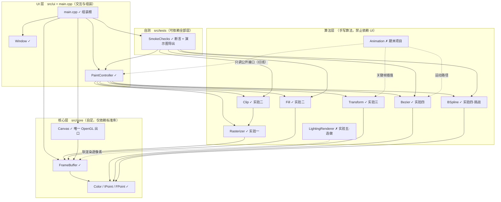
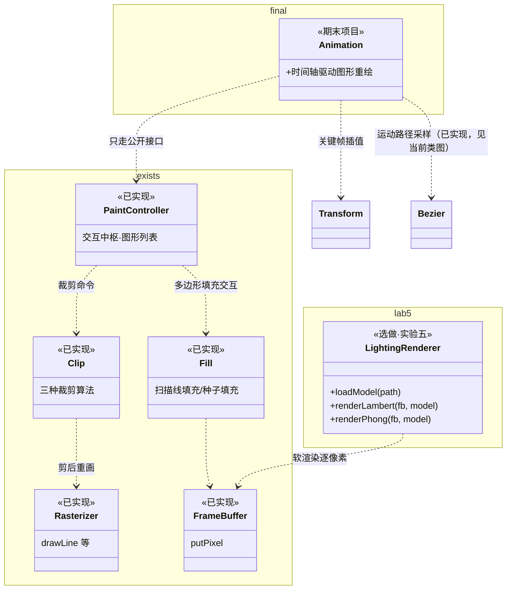

# 架构设计（类图与依赖）

> 本文随代码演进同步更新。✓ = 已实现；✗ = 未实现（标注所属实验）。期末报告"程序结构设计"章节以本文为底稿。

## 1. 分层总览

实线 = 当前已存在的依赖；虚线 = 未来模块接入后的依赖。

## 2. 类图（按功能分包）

### 2.1 当前类图

按功能模块分色分块（core / raster / ui / app）。为保持图面清爽，**值类型的字段依赖不画**（如 `Shape` 含 `LineStyle`/`IPoint` 字段、`FrameBuffer` 用 `Color`），只画组装与调用关系；完整约束见第 3 节。

```mermaid
classDiagram
    direction TB

    namespace core {
        class Color {
            +uint8 r, g, b
            +operator==(o) bool
        }
        class IPoint {
            +int x, y
        }
        class FPoint {
            +float x, y
        }
        class FrameBuffer {
            +clear(color) void
            +putPixel(x, y, color) void
            +pixel(x, y) Color
        }
        class Canvas {
            +valid() bool
            +present(fb) void
        }
    }

    namespace raster {
        class LineStyle {
            +unsigned mask
            +int width
        }
        class Rasterizer {
            <<utility>>
            +drawLine(fb, a, b, color, style)
            +drawCircle(fb, center, r, color, style)
            +drawArc(fb, center, r, deg0, deg1, color, style)
        }
        class Fill {
            <<utility>>
            +scanlineFillPolygon(fb, polygon, color)
            +scanlineSeedFill(fb, seed, fillColor)
        }
        class Rect {
            +int xmin, ymin, xmax, ymax
        }
        class Clip {
            <<utility>>
            +cohenSutherland(a, b, rect) bool
            +midpointSplit(a, b, rect) bool
            +cyrusBeck(a, b, convexWin) bool
            +insideConvex(p, convexWin) bool
        }
    }

    namespace curves {
        class Bezier {
            <<utility>>
            +deCasteljauAt(ctrl, t) FPoint
            +sampleBezier(ctrl, segments) 点列
        }
        class BSpline {
            <<utility·挑战题>>
            +clampedKnots(ctrlCount, degree) 节点矢量
            +bsplineBasis(i, p, u, knots) float
            +sampleBSpline(ctrl, degree, segments) 点列
        }
    }

    namespace ui {
        class Window {
            +shouldClose() bool
            +swapBuffers() void
            +pollEvents() void
            +setTitle(title) void
            +loader() LoaderFn
            +fbWidth() int
            +setOnKey(cb) void
            +setOnMouseButton(cb) void
            +setOnMouseMove(cb) void
            +setOnResize(cb) void
        }
        class Shape {
            +Mode mode
            +IPoint a, b
            +int radius
            +float startDeg, endDeg
            +vector polygon
            +bool filled
            +vector curve 控制点表
            +bool bspline
            +int curveDeg
            +LineStyle style
            +Color color
        }
        class PaintController {
            -vector shapes_
            -vector selected_ 选中下标
            -bool handleDrag_ 柄拖拽中
            -vector selSnapshot_ 柄拖拽快照
            -bool clipOn_ 常驻裁剪
            -vector pendingCurve_ 连点中的控制点
            -bool curveBSpline_ 新曲线类型
            -bool curveDrag_ 控制点拖拽中
            -FrameBuffer committed_
            -bool dirty_
            +onKey(key, action) void
            +onMouseButton(button, action, mods) void
            +onMouseMove(pos) void
            +render(fb) void
            +title() string
            +toolbarButtons() vector
            +toolbarHeight() int
            -commitRender() void
            -copyCommittedClipped(fb) void
            -drawPreview(fb) void
            -clipLine(a, b) bool
            -transformSelected(m, rotDeg, scaleF) void
            -hitShape(p) int
            -shapeIntersectsRect(s, rect) bool
            -pickOutlineShape(p, pt, tan, skip) int
            -commitCurve() void
            -curveSamples(s) 点列
            -pickCurveCtrl(p) 图形,控制点
            -drawCurveHandles(fb) void
        }
        class Text {
            <<utility>>
            +height() int
            +textWidth(utf8) int
            +drawText(fb, x, y, utf8, color) void
        }
    }

    namespace geom {
        class Mat3 {
            +float m[3][3]
        }
        class Transform {
            <<src/geom>>
            +translate(tx, ty) Mat3
            +scale(sx, sy) Mat3
            +rotate(rad) Mat3
            +rotateAbout(px, py, rad) Mat3
            +scaleAbout(px, py, sx, sy) Mat3
            +mul(a, b) Mat3
            +apply(m, p) FPoint
        }
    }

    namespace app {
        class AppMain {
            <<main.cpp 组装根>>
            +组装 Window/FrameBuffer/Canvas/PaintController
            +--smoke / --demo / --demo-ui 分支
        }
    }

    namespace tests {
        class SmokeChecks {
            <<src/tests>>
            +runAlgorithmSelfChecks() int
            +writePPM(path, fb) bool
            +writeDemoImage(path) bool
        }
    }

    AppMain *-- Window
    AppMain *-- Canvas
    AppMain *-- FrameBuffer
    AppMain *-- PaintController
    AppMain ..> SmokeChecks : --smoke / --demo
    Canvas ..> FrameBuffer : present 上屏
    Rasterizer ..> FrameBuffer : 只经 putPixel
    Fill ..> FrameBuffer : 只经 putPixel
    Clip ..> Rasterizer : 剪后重画（由控制器调用）
    PaintController *-- "0..*" Shape : shapes_
    PaintController *-- FrameBuffer : committed_ 提交层
    PaintController ..> Rasterizer : drawShape
    PaintController ..> Fill : drawShape
    PaintController ..> Clip : clipLine
    PaintController ..> Transform : 变换选中图形
    PaintController ..> Bezier : 曲线采样折线
    PaintController ..> BSpline : 挑战题样条采样
    PaintController ..> Text : 任务栏文字
    Text ..> FrameBuffer : 只经 putPixel（GDI 栅格化/5x7 回退）
    Transform ..> Mat3
    SmokeChecks ..> PaintController : 交互状态机模拟
    SmokeChecks ..> Transform : 数学断言
    SmokeChecks ..> Bezier : 数学断言
    SmokeChecks ..> BSpline : 数学断言
```

### 2.2 未来接入图

未来模块按所属实验分包；`exists` 包是被接入的已实现类（只列名）。

## 3. 依赖规则（红线）

| 规则 | 内容 |
|---|---|
| 允许方向 | main → 各层；ui → raster/geom/curves/core；raster/geom/curves → core；core 不依赖任何本仓库模块；tests 可依赖全部层（仅测试用，不参与运行时） |
| 禁止反向 | 算法层（raster/geom/curves）**不得** include `src/ui` 下任何头文件 |
| OpenGL 边界 | 仅 `Canvas` 使用 OpenGL（自写加载器 GLLoader，LoaderFn 由 Window 注入），其余代码与 GL 无关 |
| GLFW 边界 | 仅 `Window` 使用 GLFW；算法层经回调收到的是纯 int/float 事件 |
| 画点入口 | 一切绘制最终经 `FrameBuffer::putPixel`（课程红线：算法手写；自绘任务栏文字同样只走 putPixel——系统字体由 GDI 预先栅格化成点阵再逐像素写入，非 Windows 回退 5×7 点阵） |
| 渲染分层 | `PaintController` 分"提交层（图形列表重绘，变化时才重算）+ 预览层（每帧叠加）"；种子填充等算法不每帧重放；**常驻裁剪是显示层掩码拷贝**（窗口内照抄提交层、窗口外回黑），不改提交层 |
| 期末项目 | Animation 只调 PaintController 公开接口驱动图形，不改引擎内部 |

## 4. 未来模块接入说明

- ~~实验三 Transform~~ **已接入（lab3）**：Mat3 全套实现；变换模式（键 7）鼠标单选 / Shift 多选，拖拽与方向键平移，`+/-` 等比缩放、`R/T` 旋转。**已定设计决策**：线段/多边形直接变换顶点；圆/圆弧走"变换圆心 + 等比缩放半径 + 旋转角度"的参数化处理（非等比缩放会把圆变椭圆，超出参数表达能力，不支持）；图形参数为整数像素坐标，矩阵结果四舍五入回存（连续精细变换会有 ±1px 舍入，拖拽平移用整数增量规避）。挑战题：`J` 对接拼接——吸附两图形轮廓最近点为对接点，对 B 施加 M = T(A−B)·R(B,Δθ)（Δθ 为两切向角差，±90° 内取最短）。
- ~~实验四 Bezier~~ **已接入（lab4，#46/#47）**：de Casteljau（`sampleBezier`/`deCasteljauAt`）+ 挑战题 clamped B 样条（`sampleBSpline`，Cox-de Boor）。曲线模式（键 8）：连点控制点、右键提交、**拖拽控制点实时改形**、`B` 键切样条；曲线以 128 段采样折线渲染。**已定设计决策**：控制点表用 `FPoint` 浮点存储，变换直接作用控制点、保留浮点精度（与多边形取整回存不同）；曲线作为参数图形完整接入选中/框选/重心/对接（重心=控制点平均，与多边形同口径）。
- **实验五（选做）LightingRenderer**：独立三维支线，仅依赖 FrameBuffer 软渲染（Lambert/Phong 逐像素），不与 2D 交互耦合；模型文件放 `assets/`。
- **期末项目 Animation**：时间轴/关键帧驱动 Shape 列表做变换，复用实验三矩阵与实验一/二图元；**运动路径可直接用 curves 模块采样**（Bezier/B 样条即动画轨迹），只走公开接口。

## 5. 已知架构债（后续顺手清理）

1. `Window.hpp` 为复用 `LoaderFn` 而 include 了 `Canvas.hpp`——`LoaderFn` 已移至 `core/GLLoader.hpp`，把 `Window.hpp` 的 include 改为 GLLoader.hpp 即可彻底解开（顺手清理项）。
2. `PaintController` 是交互中枢，实验三/四接入后职责会继续膨胀——届时视情况拆出 `ShapeDocument`（图形列表+选中）与工具类。
3. ~~`Shape` 用参数化字段存圆/弧，实验三变换时需按类型分支处理~~ 已解决：applyToShape 按类型分支（lab3），决策记录见上文与 issue #35。
4. 种子填充以画板像素为操作对象（教材做法）：若后续引入反走样（CH4）使边界出现过渡色，需改为"按边界色判据"的填充。

## 附：交互状态机（实验一/二/三/四）

| 模式（键） | 交互 |
|---|---|
| 直线/圆（1/2） | 左键拖拽：按下定起点（圆心），移动预览，松开提交 |
| 圆弧（3） | 两阶段：拖拽定圆心/半径/起点角 → 移动调终止角 → 左键确认 |
| 多边形（4） | 左键连点加顶点（橡皮筋预览）→ 右键闭合（≥3 点）；`F` 切填充/仅轮廓（连点中=本次；其他=最后一个已闭合多边形） |
| 种子填充（5） | 左键点击封闭区域内一点即填充；`X` 循环填充色 |
| 裁剪（6） | 左键拖拽画线（算法演示：灰虚线原段+绿实线裁剪段）；`K`+拖拽设矩形窗口；`P`+连点+右键闭合设凸多边形窗口；`M` 切换 C-S/中点分割。**显式定义窗口后常驻裁剪开启**：窗口青色虚线常驻所有模式，只显示窗口内内容；`V`/任务栏开关 |
| 变换（7） | 左键选中（Shift 加选/移除）；**空白处拖拽框选**（橡皮筋矩形，相交全选，Shift 叠加；微点=清除）；拖拽/方向键平移；**画板式选择**：橙色高亮+虚线外接矩形+控制柄（单选线段=拖两端点改形；角柄缩放/边柄单轴缩放；含圆/弧=4 角柄等比）；`Del` 删除选中；`+/-` 缩放；`R/T` 旋转；`G` 参考点 重心↔指定；`J` 对接拼接（点 A 轮廓 → 点 B 轮廓） |
| 曲线（8） | 左键连点加控制点（以光标作临时末控制点实时预览曲线）→ 右键提交（≥2 点）；`B` 切新曲线类型 Bezier⇄B 样条；**点住已提交曲线的控制点拖拽**实时改形（控制多边形灰虚线+青色手柄，拖拽点橙色高亮） |
| 任务栏（任意模式） | 顶部两行自绘按钮（系统字体中文标签）= 全部键盘操作的鼠标等价物；与键盘共用 `handleAction` 入口；点中按钮的事件不落入画布 |
